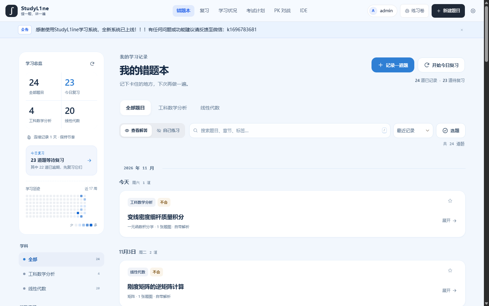
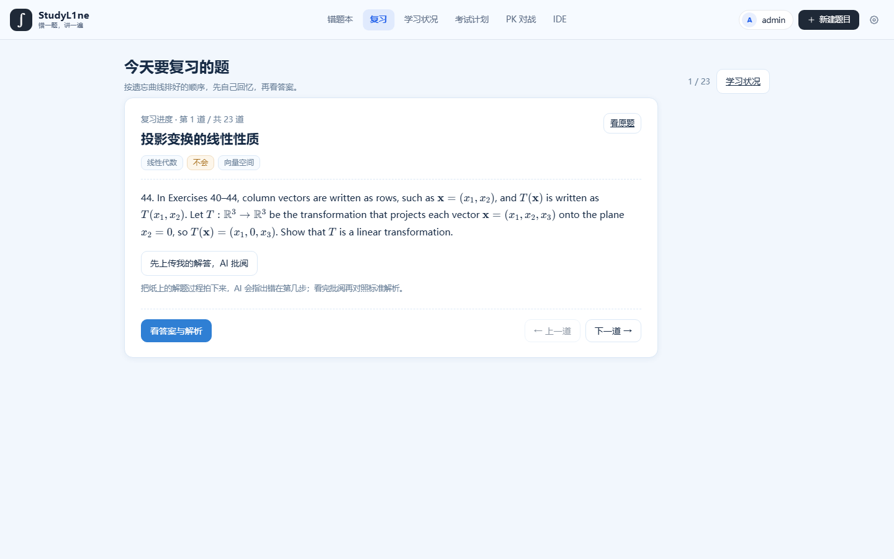
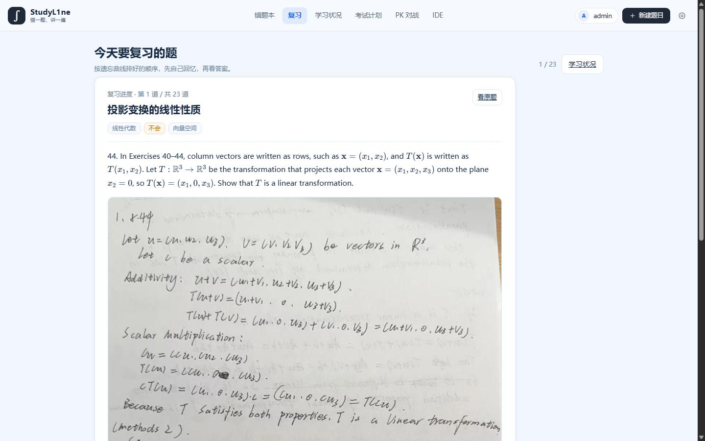
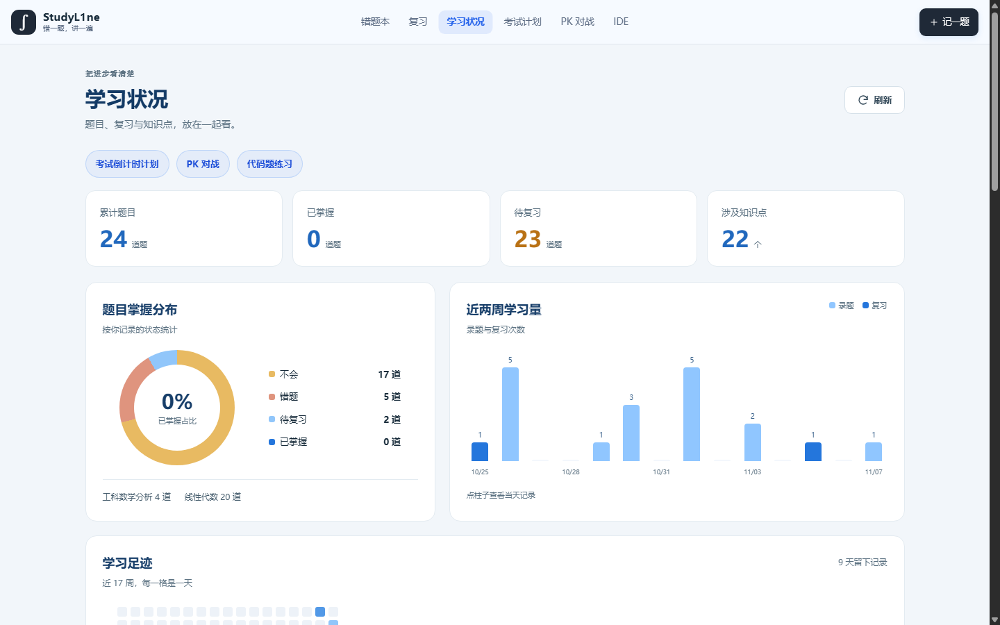
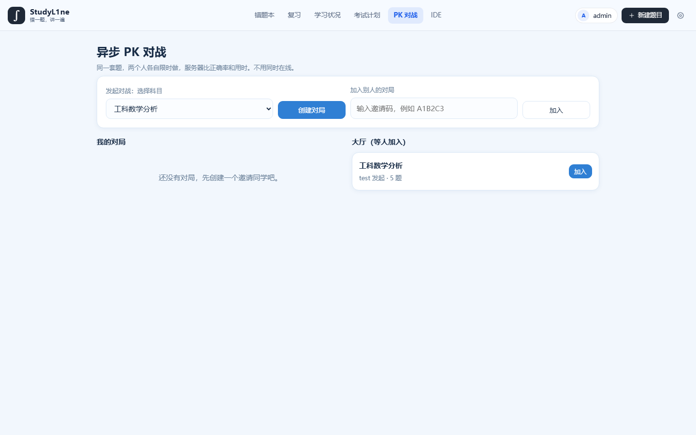
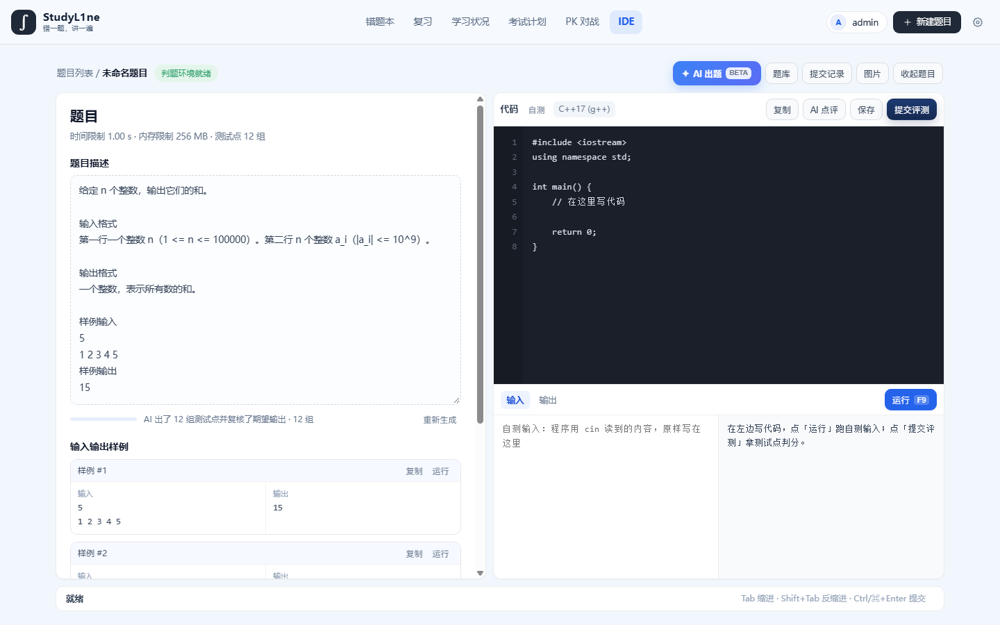

# StudyL1ne

> 错一题，讲一遍。

多学科错题本：**拍照录题 → 间隔复习 → AI 批阅 → 讲题验证 → 考试计划 / 异步 PK / 在线 IDE**。
自建服务器上跑的一套完整闭环，数学分析、线性代数、C++ 程序设计一把抓。



## 为什么做这个

错题本最常见的两个失败：**收藏了几百道题但从不复习**，和**复习时看不懂就翻答案，以为自己会了**。

StudyL1ne 把"记录"到"真懂"这条链路补全：

- **会回来找你** —— 每道题按遗忘曲线安排下次复习，到期自动进队列，不用自己记
- **先写再看** —— 复习时不直接给答案：先自己在纸上做，拍照让 AI 指出"错在第几步、错在哪一步上"，然后才展开标准解析
- **讲给 AI 学生听** —— AI 扮演零基础学生追问五轮，讲不清的地方当场暴露（费曼技巧）
- **有 deadline 就自动排** —— 输入考试日期，按每题的复习节奏铺出考前每天该看哪几道

## 功能

| 模块 | 说明 |
| --- | --- |
| 拍照录题 | 拍题目图片，视觉模型识别成文字 + LaTeX，自动归类章节与知识点，可自动解题 |
| 多学科 | 科目可自建并指定类型（数学 / 程序设计 / 英语 / 其他），不同学科套用不同知识点目录 |
| 间隔复习 | `忘了 / 勉强 / 会了 / 很熟` 四档，对应 1/2/4/7/15/30/60/120/240 天的间隔 |
| 拍照批阅 | 复习时上传手写过程，AI 定位错因、给出正确思路，并回写到题目记录 |
| 我来讲解 | 学生讲给 AI 学生听，五轮追问后给出掌握度与薄弱点 |
| 考试计划 | 设定考试时间，自动生成考前每日复习计划，可逐项勾掉 |
| 异步 PK | 邀请码 / 大厅匹配，同科目抽 5 题、限时 8 分钟，比正确率和用时；可传手写拍照判分，交卷后统一出解析 |
| 在线 IDE | C++ 在线编译评测：AC / WA / TLE / RE / CE 判定方块、提交记录、按知识点 AI 出题 |
| 学习状况 | 掌握分布、近两周学习量、知识点热力、错题时间线、练习卷打印 |

## 界面

复习页：先自己写，再看批阅与解析



上传手写过程后，AI 指出错在哪一步



学习状况



异步 PK：对局中不透露对错，交卷后逐题核对 + AI 讲解



在线 IDE：写题面自动生成并复核定测试点



## 技术栈

| 层 | 选型 |
| --- | --- |
| 后端 | Flask + Waitress，单文件主应用 + 蓝图拆分 |
| 数据 | SQLite（WAL 模式）、JSON 字段存标签与附件、每日备份 |
| 前端 | 原生 JS（无框架、无构建），KaTeX 渲染公式，响应式 + 移动端底部导航 |
| AI | 任意 OpenAI 兼容接口（默认 DeepSeek），视觉模型做 OCR 与批改，结构化 JSON 输出 |
| 判题 | Docker 沙箱：无网络、256MB 内存、1 核、3 秒超时、`cap-drop ALL`、`no-new-privileges` |
| 部署 | systemd 守护 + 反向代理（nginx / Caddy），HTTPS 与独立 Cookie 名隔离多应用 |

## 快速开始

```bash
git clone https://github.com/DOGEEER6/StudyL1ne.git
cd StudyL1ne

python3 -m venv .venv && . .venv/bin/activate
pip install -r requirements.txt

cp .env.example .env        # 至少改 MATH_DATA_DIR 和 MATH_ACCESS_CODE
./start.sh                  # 默认 http://127.0.0.1:8787
```

首次访问用 `MATH_ACCESS_CODE` 注册第一个账号（自动成为管理员），之后可在后台发邀请码。

**AI 功能是可选的**：不填 Key 时录题、复习、统计、打印全部可用，只有 AI 解析 / 批阅 / 出题会提示未配置。

想用在线 IDE，需要先构建判题镜像（`judge.py` 里默认镜像名 `secondpass-judge:latest`）：

```bash
docker build -t secondpass-judge:latest - <<'EOF'
FROM python:3.12-slim
RUN apt-get update && apt-get install -y --no-install-recommends g++ && rm -rf /var/lib/apt/lists/*
EOF
```

## 配置

| 环境变量 | 说明 |
| --- | --- |
| `MATH_DATA_DIR` | 数据目录（数据库、上传图片、备份、密钥都在这里），建议挂在大盘上 |
| `MATH_PORT` | 监听端口，默认 8787 |
| `MATH_ACCESS_CODE` | 首次注册用的访问码 |
| `MATH_COOKIE_SECURE` | 走 HTTPS 时设 `1` |
| `MATH_SESSION_COOKIE_NAME` | 同机多应用时用它隔离 Cookie，默认 `session` |

AI Key、模型、额度在后台「AI 引擎」页配置，落盘在数据目录，**不进代码库**。

## 部署

```ini
# /etc/systemd/system/studyl1ne.service
[Unit]
Description=StudyL1ne
After=network.target

[Service]
User=studyl1ne
WorkingDirectory=/srv/StudyL1ne
EnvironmentFile=/srv/StudyL1ne/.env
ExecStart=/srv/StudyL1ne/.venv/bin/python serve.py
Restart=on-failure
UMask=0022

[Install]
WantedBy=multi-user.target
```

反向代理把 HTTPS 终止在外层，转发到 `127.0.0.1:8787`；务必设置 `MATH_COOKIE_SECURE=1`，同机有其它应用时另设 `MATH_SESSION_COOKIE_NAME`。更细的说明见 [docs/HTTPS_DEPLOYMENT.md](docs/HTTPS_DEPLOYMENT.md)。

## 目录结构

```
app.py            # 主应用：页面、条目、复习、AI 调用、后台
serve.py          # Waitress 启动入口
v3_api.py         # 考试计划 / PK / 讲解 / 批阅 / 代码题 接口（蓝图）
judge.py          # Docker 判题（编译、运行、限资源）
subjects.py       # 学科与类型（数学 / 程序设计 / 英语 / 其他）
learning.py       # 知识点目录与学习状况统计
v3_schema.py      # 增量迁移（新增表与列）
schema.sql        # 基础表结构
templates/        # Jinja2 模板
static/           # CSS / JS / 图标，无构建步骤
docs/             # 部署、版本控制、HTTPS 说明
tests/            # 可独立运行的回归测试（用临时库，不碰生产数据）
submission/       # 项目说明、技术实现、验证记录
scripts/          # 打包与维护脚本
```

## 安全与隐私

- 所有数据留在自己的服务器：题目、截图、复习记录不经过第三方
- 密钥、数据库、上传目录、日志都不在版本库里（`.gitignore` + 提交前扫描脚本）
- 判题在容器里跑：无网络、限内存与 CPU、限制进程数、`cap-drop ALL`
- 写操作校验 `Origin` 与 CSRF Token；会话用独立 Cookie 名，可一键踢下线

## 已知限制

- 判题只支持 C++17，交互式题目（需要实时按键）无法自动判分，只能自测 + AI 点评
- AI 生成测试点仍可能偶发格式错误，已加提示词约束与"从残缺 JSON 抢救"的兜底，但建议提交前看一眼样例
- 单机部署，未做多实例与读写分离；SQLite 足够个人 / 小班使用

## 致谢

界面灵感来自各类在线判题站的 IDE 布局；数学公式渲染用 [KaTeX](https://katex.org/)。

## 许可

[MIT](LICENSE) © 2026 DOGEEER
